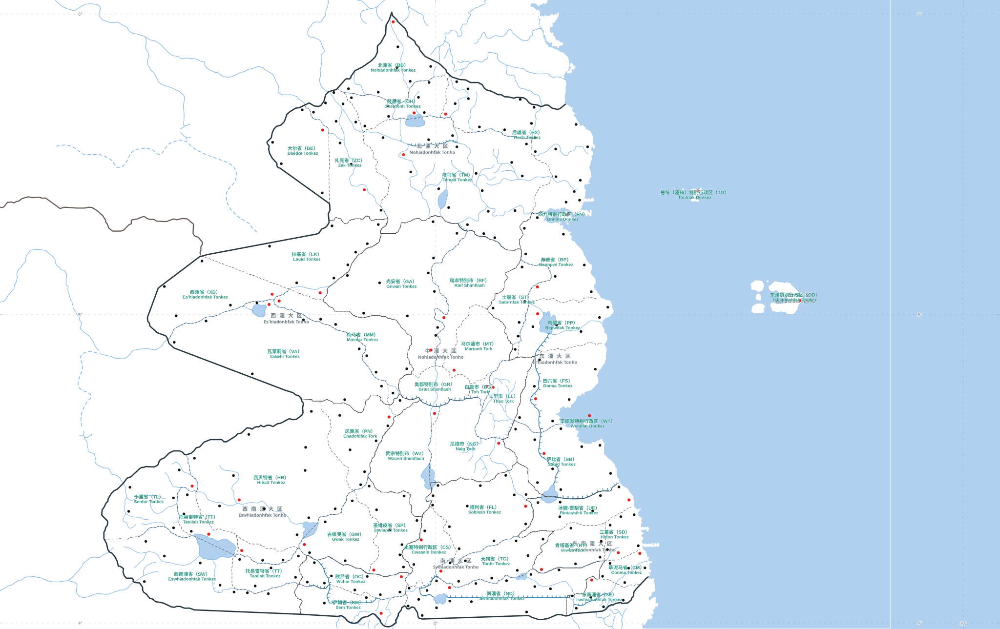

# Duniverse

## 湩国行政区划图

Duniverse 是一份交互式地图与地图数字化项目。它将《湩国行政区划图（2026 年第六版）》整理为可缩放的浏览器地图，并提供行政区、边界、水系、城市和文字标注等独立图层。



## 打开地图

无需安装应用或下载依赖，直接用浏览器打开仓库中的 [`index.html`](index.html) 即可。也可以从项目目录运行一个本地静态服务器：

```bash
python -m http.server 8000
```

然后访问 <http://localhost:8000>。

## 地图操作

- 滚动鼠标滚轮缩放地图，拖动地图平移视图。
- 地图叠加土星自定义坐标网格：纬度每 1°、经度每 10°一条浅色半透明细虚线；边缘刻度使用本项目的数字度数，不显示方向字母。自定义纬度等于真实行星纬度的六分之一。
- 在顶部搜索框输入中文名、湩语名、行政区编号或城市邮政区号，可从动态候选项中选择大区、省级行政区或城市；选择后地图会定位到有确认位置的对象，并显示介绍、各级名称、湩语名称和面积。城市没有可核实的位置或面积时会明确显示暂无数据。
- 点击地图上的省级行政区也会打开对应信息；缺少介绍内容时显示“暂无介绍”。
- 右侧图层可分别显示或隐藏行政区边界、大区边界、水系、城市标记和行政区名；行政区名分为“编号”和“中文”两个子图层。
- 宏观视图会显示大区双语名称，中文在上、湩语小字在下；名称保持固定屏幕尺寸，进入省级视图前逐渐淡出。
- 行政区编号和中文名称随放大同步淡入，继续放大后同步淡出；两个子图层仍可独立开关。
- 放大后地图会显示更多细节。海岸线填充在约 65% 的缩放进度达到最高几何精度，宏观视图会暂时隐藏过小的岛屿。

## 项目内容

- **交互式地图**：Canvas 绘制行政区和地图要素；支持缩放、平移、区域定位与分组图层控制。
- **行政区标注**：两字母编号与对应中文名称并列显示，可分别开关。
- **矢量预览**：[`vector_preview.svg`](vector_preview.svg) 可直接在浏览器、Inkscape 或 Illustrator 中打开。
- **地图数据**：提取并整理了行政区面、共享省界、大区界、国境线、邻国边界、海岸线、河流、运河、湖泊、城市及省会标记。
- **地区与城市搜索**：支持按中文名、湩语名、行政区编号和城市邮政区号动态搜索；地区和城市的层级名称、湩语名称、面积及介绍数据分别维护在 [`data/region_directory.js`](data/region_directory.js) 与 [`data/city_directory.js`](data/city_directory.js)。城市清单以启用的 `cities.js` 记录为准，注释中的隐匿城市不纳入搜索；地图上未能确认位置的城市仍可搜索并查看资料。
- **数据处理工具**：仓库包含地图要素提取、边界生成和水系样式处理脚本，便于继续修订和重新生成图层。

概览时显示大区界和大区双语名称，不显示省界；逐渐放大时大区名先淡出，随后省名和编号淡入，并切换为更细的虚线省界。继续放大后，大区界和省界按层级隐藏。边界线在缩放时保持屏幕粗细不变。海岸线不作为大区边界绘制。大区归属与湩语名称维护在 [`data/major_region_membership.json`](data/major_region_membership.json)，大区名称标注位置记录在 `data/major_region_labels.geojson`。

## 仓库结构

| 路径 | 用途 |
| --- | --- |
| `index.html` | 浏览器交互地图与 Canvas 渲染逻辑 |
| `vector_preview.svg` | 独立矢量地图预览 |
| `input_map.png` | 基础地图图像 |
| `Administrative-Division-Map-of-Donh-2026.png` | 高清地图图像，用于细节核对和水系描绘 |
| `data/` | 行政区、水系、海岸、标记和名称等地图数据 |
| `extract_map_features.py` | 从基础图像提取地图要素及 OCR 候选 |
| `extract_context_layers.py` | 提取海域、邻国边界和跨境河流候选 |
| `build_administrative_boundaries.py` | 生成共享省界、大区界及大区名称标注 |
| `extract_hydrology_styles.py` | 处理河流、季节性河流和运河图层 |
| `tools/` | 高清分块海岸线处理工具 |
| `diagnostics/` | 数据提取和海岸线复核时生成的诊断材料 |

行政区中文名称和湩语名称分别维护在 [`data/province_names.json`](data/province_names.json) 与 [`data/province_tongue_names.json`](data/province_tongue_names.json)，标注位置维护在 `data/region_code_labels.geojson`。地图标签按“中文（编号）”和下一行湩语显示，中文与湩语图层可分别开关。目前地图包含 45 个两字母行政区编号；其中 `TT` 在地图上有两个标注位置。

## 重新生成数据

地图页面已经包含当前展示所需的数据，日常使用不需要 Python。仓库中的脚本用于修改或重新生成数据层：

```bash
python extract_map_features.py input_map.png --out .
python extract_context_layers.py
python tools/extract_official_coastline_tiled.py --source-dir "path/to/official_map"
python build_administrative_boundaries.py
python extract_hydrology_styles.py
```

这些步骤应在对应源图和数据准备完成后按顺序运行。将示例路径替换为官方高清地图所在目录；该源图目录不包含在本仓库中。`extract_context_layers.py` 也会生成基础海岸线候选，精细海岸线使用分块工具生成。

提取流程依赖 Python 及相应图像和地理数据处理库，包括 OpenCV、NumPy、Pandas、Pillow、Shapely、SciPy 和 scikit-image。OCR 提取还需要安装 Tesseract，并提供中文、英文语言包。各工具的其他参数可查看脚本说明或运行 `--help`。

## 坐标与数据说明

原图没有比例尺或地理控制点，所以基础图层仍以图像像素存储：原点在左上角，横轴向右、纵轴向下。项目另建立了一套根据给定国土面积定标的土星坐标参考，参数见 [`data/georeference.json`](data/georeference.json)，测绘假设和公式见[《湩国地图测绘报告》](saturn-map-survey-report.md)。该坐标系以土星 1 bar 参考椭球为基准，臭都为 0°经线、地图纬度约 4.7833°N（对应真实行星地理纬度约 28.7°N）；真实纬度 ±90°按六分之一记为地图纬度 ±15°，经度仍为东向 360°一周。

可用 `tools/georeference_map.py` 把像素点或现有 GeoJSON 转为该项目坐标。批量结果写入 `data/georeferenced/`，并标记为自定义土星坐标；这些坐标不是 WGS 84 / EPSG:4326，也不是官方地图原有的 GIS 坐标。

边界和标注位置来自原图提取、矢量化或人工复核，适用于地图展示和项目编辑，不应视为官方 GIS 边界数据。

中文行政区名称根据项目附带的《湩国政区清单》逐项核对。原图标题、版本、制作方和版权信息见 [`data/map_metadata.json`](data/map_metadata.json)。

## 许可

仓库中的代码按 [`LICENSE`](LICENSE) 所列 Apache License 2.0 发布。原版地图图像及其版权声明以 `data/map_metadata.json` 和图像文件中的标注为准。
