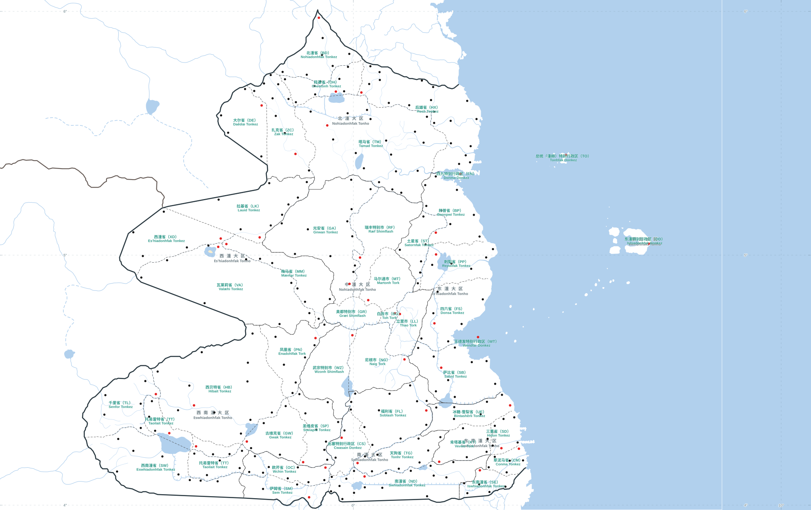

# Duniverse

Duniverse 围绕虚构世界《𣿅国行政区划图》制作。它是一份交互式地图，也是地图数字化项目。地图可以缩放、搜索，图层可以单独开关。项目保留边界、水系和地形数据的处理与核对材料。

[打开在线地图](https://dorngames.github.io/Duniverse/) · [查看项目发布说明](docs/PROJECT_RELEASE_NOTES.md) · [浏览代码](https://github.com/DornGames/Duniverse)



## 快速开始

### 在线查看

打开 [GitHub Pages 地图](https://dorngames.github.io/Duniverse/)，无需安装软件。

### 在本地查看

在项目根目录运行下面的命令，然后访问 `http://localhost:8000`：

```bash
python -m http.server 8000
```

地图页面是 `index.html`。若只想看静态图，可直接打开 [矢量预览](vector_preview.svg)。

## 地图可以做什么

- 滚动鼠标滚轮或双指捏合来缩放；拖动地图来平移。
- 搜索中文名、𣿅语名、行政区编号或城市邮政区号，定位到国家、大区、省份、城市、山峰和已命名河流。
- 点击地图要素查看可用介绍；点击大区或省份查看模型计算的海拔统计。右键地图陆地位置可查询估算海拔，点击海洋可查询估算水深。
- 在图层面板中切换行政区、城市、道路、高铁、水系、海底深度、山峰和地形晕渲等内容。

具体操作和数据含义见[项目发布说明](docs/PROJECT_RELEASE_NOTES.md)。

## 项目由哪些部分组成

| 部分 | 内容 |
| --- | --- |
| 交互地图 | `index.html` 使用 Canvas 显示地图和图层。 |
| 地图数据 | `data/` 保存 GeoJSON 边界和线要素，以及名称、坐标和地形数据。 |
| 处理工具 | `tools/` 和根目录中的 Python 脚本用于提取、整理、转换和审阅数据。 |
| 核查记录 | `docs/`、`diagnostics/` 和报告文件记录局部修正、审计方法与结果。 |

## 开始阅读

- [项目导览](docs/PROJECT_OVERVIEW.md)：地图各部分如何连接，重要文件在哪里。
- [数据、坐标与精度边界](docs/DATA_AND_LIMITS.md)：哪些内容来自原图，哪些经过推算，以及数据适合怎样使用。
- [开发与数据复现](docs/DEVELOPMENT.md)：如何本地运行地图、使用脚本和查看海岸线审阅工具。
- [项目发布说明](docs/PROJECT_RELEASE_NOTES.md)：面向第一次认识项目的读者，概述当前功能与版本背景。
- [地图测绘报告](saturn-map-survey-report.md)：项目自定义土星坐标参考的参数、公式和限制。
- [山脉与海拔模型说明](data/mountain_elevation_model.md)：山峰、地形假设和水文核查口径。
- [特征提取报告](FEATURE_EXTRACTION_REPORT.md)：首轮图像提取的结果和质量限制。
- [海岸线审阅工具说明](tools/README.md)：如何查看像素审阅页面并记录人工判定。
- [GitHub 版本记录](https://github.com/DornGames/Duniverse/releases)：按正式版本查看历史更新。

## 数据与授权说明

原图没有经纬网、比例尺或地理配准。地图底层几何仍使用图像像素坐标；项目另建的土星坐标参考是按给定面积定标的制图假设，不是官方 GIS 坐标。地形和海底深度也是项目模型值，不是实地测量结果。使用边界、坐标或海拔数据前，请先阅读[精度边界说明](docs/DATA_AND_LIMITS.md)。

代码按 [Apache License 2.0](LICENSE) 发布。原版地图图像的署名和版权信息记录在 `data/map_metadata.json` 中；代码许可不表示原版地图图像也采用同一许可。