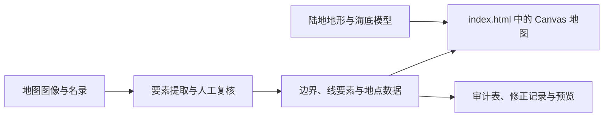

# 项目导览

本文说明 Duniverse 地图由哪些部分组成，以及数据如何到达浏览器页面。第一次查看项目时，可先从根目录的 `index.html` 和 `data/` 开始。

## 一张图如何变成多层地图

地图图像提供轮廓和标注依据。脚本从图像生成候选几何，人工复核后再将数据交给网页绘制。地形与海底模型根据现有地图要素生成，再由独立图层显示。

## 主要组成

| 组成 | 作用 | 从哪里看 |
| --- | --- | --- |
| 浏览器地图 | Canvas 绘图、缩放平移、搜索和图层控制。 | [`index.html`](../index.html) |
| 行政区与边界 | 保存行政区面、省界、大区界、国境线和邻国边界。 | [`data/`](../data/) 中的 GeoJSON 文件 |
| 海岸和水系 | 保存海岸线、河流、运河、湖泊和跨境水系。 | [`data/`](../data/) 中的 GeoJSON 文件及修正记录 |
| 地名和交通 | 保存城市、山峰、湖泊、道路、高速路线和车站资料。 | [`data/`](../data/) 中的 JS、JSON 文件 |
| 地形模型 | 保存陆地高程、地形着色、山脊和海底深度数据。 | [`data/mountain_elevation_model.md`](../data/mountain_elevation_model.md) |
| 数据工具 | 提取图像要素，生成边界、统计表、坐标目录或审阅页面。 | [`tools/`](../tools/) 和根目录 Python 脚本 |
| 核查材料 | 保留报告、审阅图和局部修改说明。 | [`docs/`](../docs/)、[`diagnostics/`](../diagnostics/) |
| 矢量预览 | 在地图页面之外查看静态 SVG。 | [`vector_preview.svg`](../vector_preview.svg) |

## 目录里的数据是什么

- GeoJSON 文件存放边界、海岸、水系和河道等几何。
- JavaScript 文件向地图页面提供常用图层、名称目录和地形栅格。
- JSON 文件记录元数据、名称映射、坐标参数和修正批次。
- CSV 文件用于复核坐标、统计值和水文关系。

不同文件可能表示原始候选、人工修订结果或模型推算结果。查看文件时，应同时检查元数据和相关报告，不能只凭扩展名判断精度。

## 建议的阅读顺序

1. 在 [在线地图](https://dorngames.github.io/Duniverse/) 中认识交互方式和图层。
2. 阅读[项目发布说明](PROJECT_RELEASE_NOTES.md)，了解当前功能和正式版本背景。
3. 查看[数据、坐标与精度边界](DATA_AND_LIMITS.md)，分清底图像素、自定义坐标和模型估值。
4. 需要重建数据时，再按[开发与数据复现](DEVELOPMENT.md)中的步骤运行脚本。
5. 对照[特征提取报告](../FEATURE_EXTRACTION_REPORT.md)、[地图测绘报告](../saturn-map-survey-report.md)和具体批次的审阅记录查看处理依据。