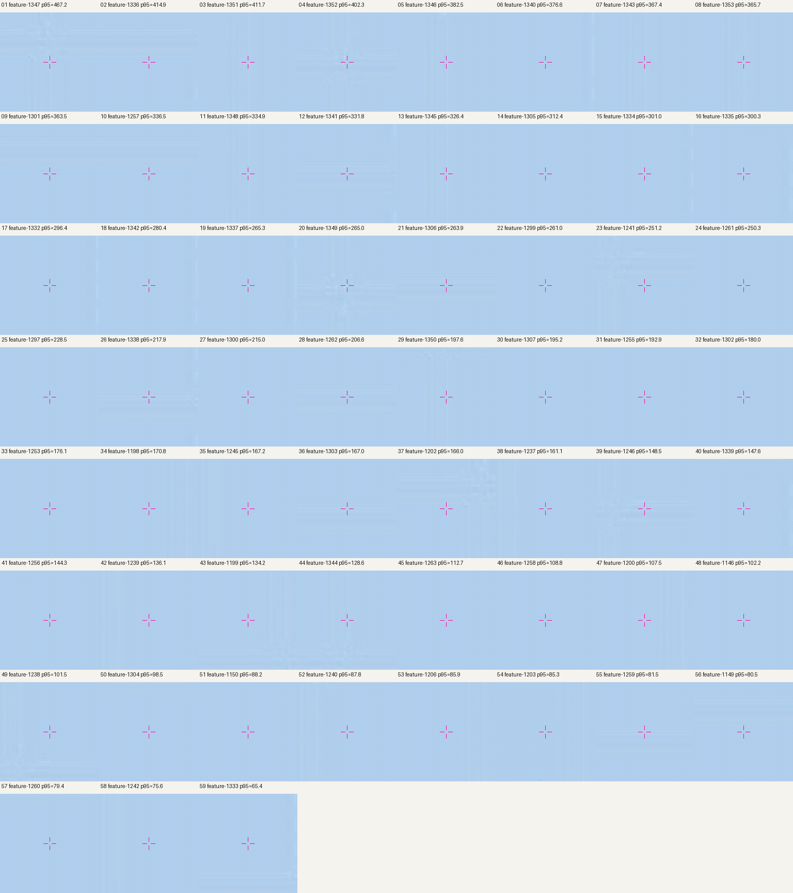

# ??????? 1/3

???2026-11-05

## ????

???????? 59/177 ????????????????????????????????????????????? 78 ??????????? p95 ???????? 59 ???????????? 12? ?????????

????????? 0.30 ?????????? 1024?1024 ??????12????????? 0.015 px??59 ???????????????????????????? 59 ???? p95 ??? 65.3689 px????????? 63.2876 px??? 19 ??????????????

## ????

- ?? 59 ??????????? `island_shoreline` ???
- ???? 979 ????????????? 375 ??? 316 ?????? 1,354 ??? 1,295 ??
- ?? GeoJSON ????????????
- ???? `input_map.png` ????????? 12?????????? `X12=12x+5.5, Y12=12y+5.5`???????????????????p95 ?????????? [`coastline_correction_batch_01.json`](../data/coastline_correction_batch_01.json)?

## ??????

???? 59 ? 64?64 ?? 12? ???????????????????????

- ???? SHA-256?`8be5565fe8e6fbfe346c22bf05110e31aa6af00331a054959f07e71c1a69b75a`
- ??? SHA-256?`8897d8c95f55c67979c5f0ddd96bccbde4ccf8d52c4f03014db6bf31f21f7fd4`
