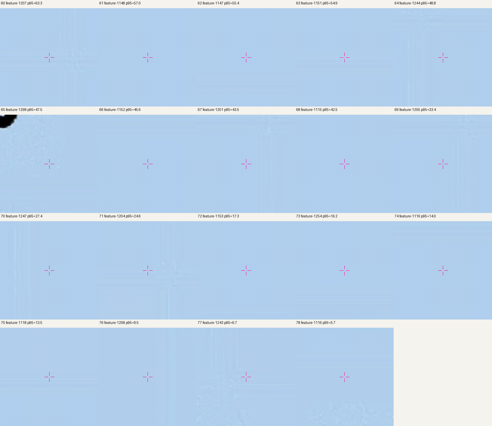
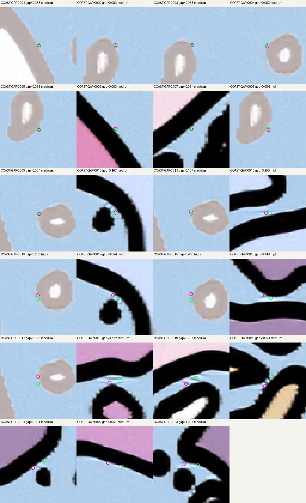
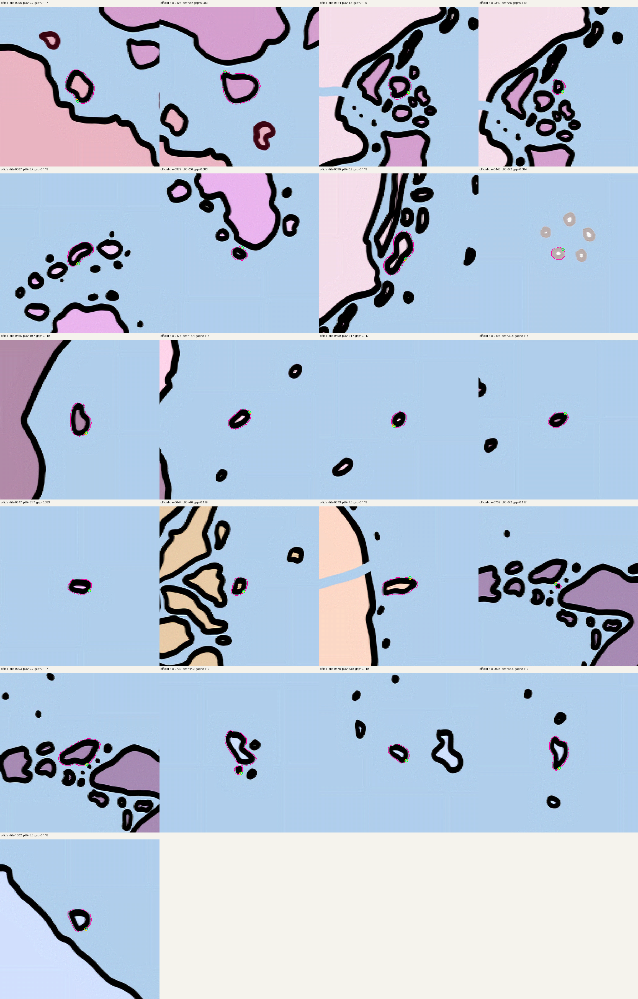

# 海岸线修正批次 2/3

日期：2026-11-05

## 本批范围

本批解决 59/177 条可处理候选问题，累计完成 118/177 条。修正集中在三类有高分辨率图像支持的几何问题：19 个剩余的瓦片交点微环、17 条近闭合岸线、23 组短端点断开。

## 修改内容

- 删除 19 个闭合微环。每个微环长度小于 0.30 底图像素，中心位于 1024×1024 源图块交点；对应 12×裁片均显示开阔水面，没有岸线墨迹。
- 闭合 17 条近闭合岸线。其端点间距小于 0.15 底图像素，并且连接处沿线 21 个采样点均在 12×原图的暗色岸线笔画 2 px 内。3 条缺少笔画支持的线和 1 条岛屿/地图符号含义不明的线保留待后续复核。
- 为 23 组端点断开添加短连接线。长度范围为 0.083–1.004 底图像素，均有 100% 的开海岸线栅格支持。连接线使用现有两个岸线端点的原始坐标，保持原坐标系偏移。

每条修正记录及底图像素坐标、参考图 12×坐标、几何长度、瓦片、岸线支持率和原始要素索引，见 [`coastline_correction_batch_02.json`](../data/coastline_correction_batch_02.json)。坐标是 `input_map.png` 像素中心索引，不是经纬度。转换到 12×图像素中心索引的公式为 `X12=12x+5.5, Y12=12y+5.5`。

## 数据变化

- 输入：1,295 条要素（979 条开放海岸线、316 条闭合岛岸线）。
- 输出：1,299 条要素（1,002 条开放海岸线要素、297 条岛岸线要素）。其中 17 条开放海岸线被闭合，另添加 23 条短连接要素。
- 闭合线共 314 条：297 条岛岸线和 17 条新闭合海岸线。原有 1 条自接触闭合线保留；它闭合但不是简单环。
- 本批之外的 59 条候选留待第三批。

## 12×原图复核

剩余瓦片交点微环：

断头连接位置（紫红与绿色圆圈标出两个原端点）：

近闭合岸线复核（紫红线为原矢量）：

参考图是本地 12×项目清理图；现有资料无法独立认证其为官方原始出版图。

- 修正前 SHA-256：`8897d8c95f55c67979c5f0ddd96bccbde4ccf8d52c4f03014db6bf31f21f7fd4`
- 修正后 SHA-256：`36d06e5c7f3db67db96c01b424325b6180c8594ad85710f8eaf41b014a2ef73f`